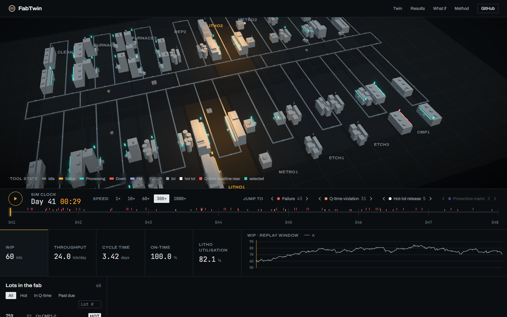
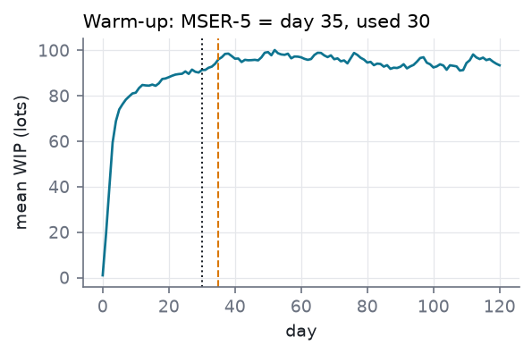
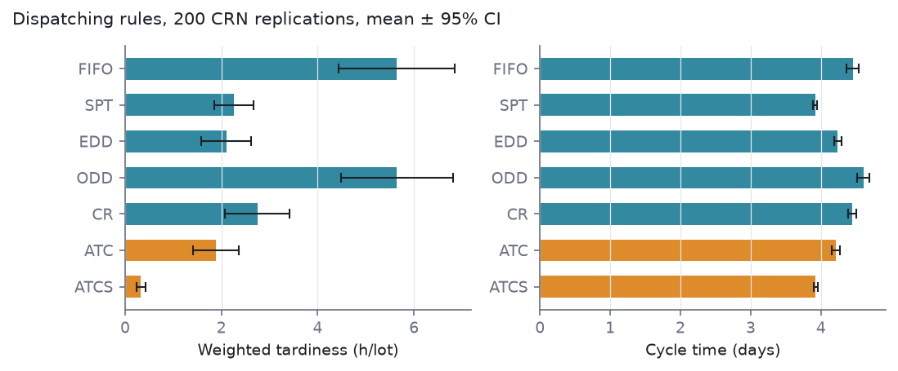
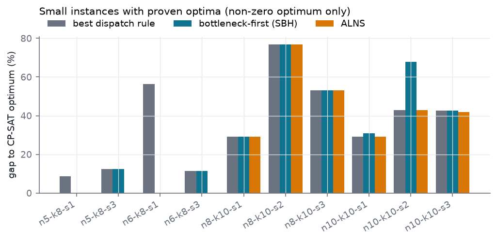
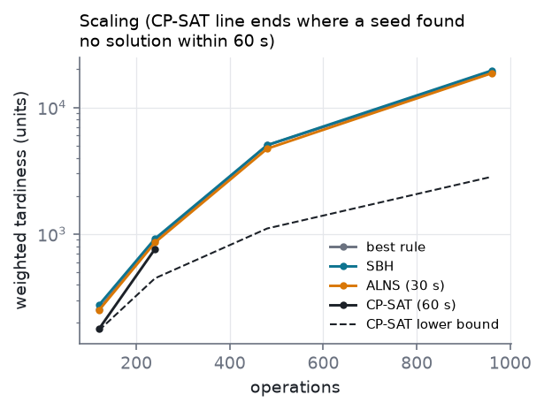
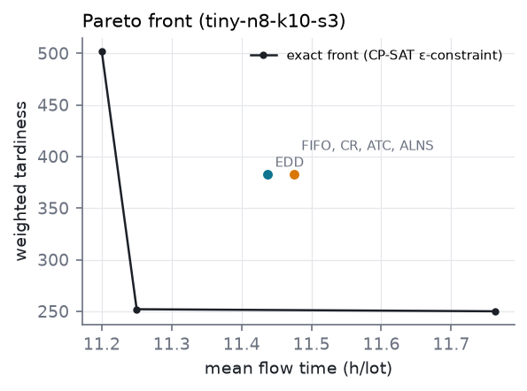
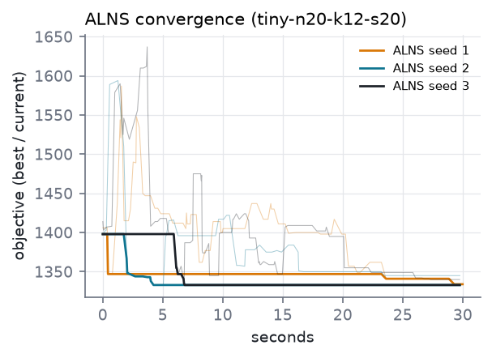
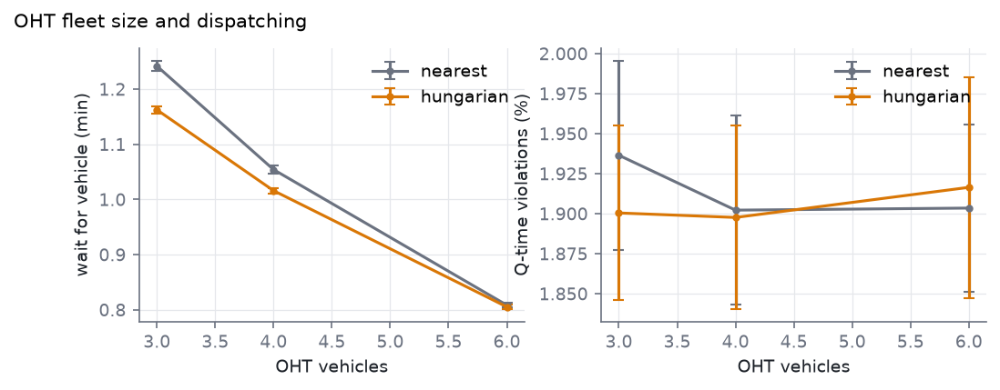
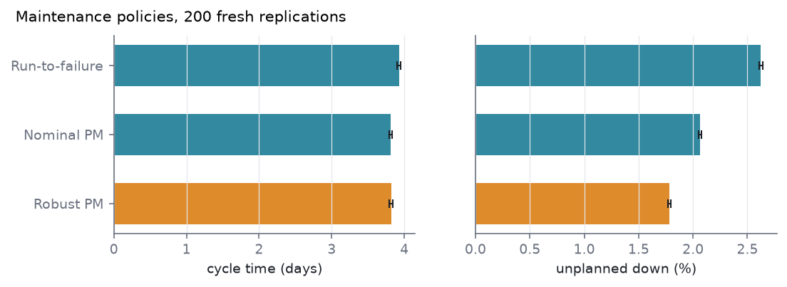
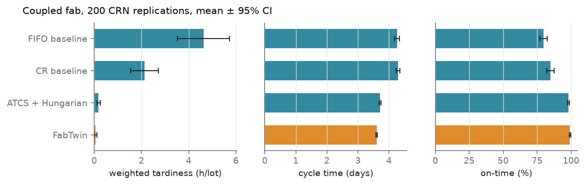

# FabTwin

**Stochastic scheduling and transport optimisation for a semiconductor fab, with a 3D digital twin.**

[Live demo](https://atesparilti1.github.io/fabtwin/) · [Technical write-up (PDF, 2 pages)](docs/fabtwin_writeup.pdf) · [Formulation](docs/formulation.md) · [Replay data format](web/DATA_FORMAT.md)



FabTwin optimises three coupled problems of a wafer fab under uncertainty and checks every policy in a discrete-event digital twin:

1. **Scheduling.** A re-entrant flexible job shop with batching: lots revisit lithography once per mask layer, furnaces batch up to 6 lots of one recipe, scanners pay a setup on every reticle change, Q-time windows limit the wait between clean and furnace, and hot lots jump the queue.
2. **Transport.** Overhead hoist vehicles (OHT) on a directed rail network with loops and one-way shortcuts, with congestion, deadlock avoidance, and coupling to Q-time feasibility.
3. **Maintenance and uncertainty.** Weibull failures, lognormal repairs and processing times, metrology rework, random hot lots, and preventive-maintenance (PM) intervals as decision variables.

Every number in this README and in the web app is produced by a script in this repository with a fixed seed (`make bench`). Assumptions are labelled; simplifications compared with real fabs are listed at the end.

---

## Headline results

* **FabTwin policy vs critical-ratio dispatching** (coupled fab with OHT, failures, rework and hot lots; 200 paired CRN replications): weighted tardiness -97.1% (95% CI ±26.2), cycle time -16.1% (95% CI ±1.0), on-time delivery +17.0% (95% CI ±3.0).
* **vs FIFO:** weighted tardiness -98.7% (95% CI ±23.3), cycle time -15.3% (95% CI ±1.6).
* **Exact ground truth:** CP-SAT proved optimality on 12/12 small instances; the time-indexed MIP proved 6 of them and agreed on all 6. Mean gap to optimum (instances with a non-zero optimum): best dispatching rule 36.3%, bottleneck-first decomposition 32.5%, ALNS 27.3%.
* **Robust vs nominal PM:** cycle time +0.2% (95% CI ±0.2), unplanned downtime -13.7% (95% CI ±0.8); vs run-to-failure, unplanned downtime -32.0% (95% CI ±0.8) (200 fresh replications).
* **Rolling-horizon CP-SAT litho planning** on top of the FabTwin policy did not help: weighted tardiness -11.7% (95% CI ±32.2) (not significant), cycle time +2.6% (95% CI ±0.5) over 20 paired replications. It is reported because it was run.

**CV bullets** (each number traces to `results/`):

* Built a 3D digital twin of a semiconductor fab (re-entrant flexible job shop with batching, setups, Q-time, OHT transport, stochastic failures). Cut mean cycle time by 16.1% (95% CI ±1.0%) and weighted tardiness by 97% vs critical-ratio dispatching over 200 paired common-random-number replications.
* Formulated CP-SAT and time-indexed MIP (HiGHS) models as ground truth: proved optimality on 12/12 instances and measured dispatching rules at 36% and ALNS at 27% above optimum. Showed that with a 60 s limit ALNS overtakes CP-SAT between 240 and 480 operations.
* Optimised preventive-maintenance intervals under Weibull failures by simulation (common random numbers, screen-and-select). Cut unplanned downtime by 32% and cycle time by 2.7% vs run-to-failure, and showed the analytical age-replacement plan is statistically indistinguishable on cycle time (+0.2% ± 0.2%).

---

## Repository layout

```
fabtwin/core/      instance model, generator, layout + rail graph, dispatch rules,
                   static snapshot problem + decoders, CP-SAT, time-indexed MIP (HiGHS),
                   bottleneck-first decomposition, ALNS, rolling-horizon planner, maintenance
fabtwin/sim/       own discrete-event engine (failures, PM, rework, Q-time, OHT), CRN streams,
                   replication runner, output analysis (t-CIs, paired CIs, MSER-5), replay export
scripts/           bench_*.py (every table and figure), export_scenarios.py, make_figures.py,
                   build_analytics.py, build_writeup.py, build_readme.py
web/               React + TypeScript + Vite + Tailwind + react-three-fiber twin, Web Worker what-if
tests/             schedule feasibility, simulator invariants, Little's Law, CP-SAT = MIP, OHT headway
results/           JSON + Markdown outputs of the benchmarks (committed)
```

```bash
pip install -e ".[dev]"
make test          # pytest with coverage (core + sim), mypy via `make typecheck`
make bench         # regenerates every table, figure and web dataset (~45 min on 16 cores)
make web           # replay data + production build of the web twin
```

---

## The problem

### Fab model (synthetic, SMT2020-inspired)

The public SMT2020 testbed (Kopp et al., 2020) has about 1,000 tools and routes of 300–600 steps. That is too large for exact methods and for 200-replication studies in Python, so `fabtwin/core/generator.py` builds smaller fabs with the same **structure**. Each layer runs pre-clean → oxidation furnace or deposition → litho → overlay metrology (3% rework back to litho) → etch → strip, with implant + anneal and CMP on some layers, plus a 4 h clean → furnace Q-time. Each product has its own reticle per layer, furnace recipes are shared across products (batchable), and implant species cause setups. The release rate is set so the litho groups run at the target utilisation counting a setup on every visit, which makes litho the designed bottleneck. Litho dedication (each step qualified on all but one scanner) is load-balanced.

Benchmark fab `medium-s0`: **16 tool groups, 55 machines (1–6 per group), 3 products, routes of 58–69 steps with 7–8 litho visits**, 20.0 lot starts/day + 0.60 hot lots/day.

All parameter values (processing-time ranges, CVs, MTBF/MTTR/shape, PM durations, flow factors) are in `generator.py` and are stored inside every instance (`Instance.params`). They are order-of-magnitude assumptions, not fab data.

### Formulation

The full CP-SAT and time-indexed MIP formulations, the stochastic model and the maintenance model are in **[docs/formulation.md](docs/formulation.md)**. In short, the CP-SAT model is:

$$\min \sum_j w_j T_j \quad \text{s.t.}\quad \sum_{m\in M_o} x_{om}=1,\ \ S_{o_{k+1}}\ge E_{o_k}+\tau,\ \ S_{o_{k+1}}-E_{o_k}\le Q_{o_k},\ \ \textsc{Circuit} \text{ with setups},\ \ \text{batch synchronisation},\ \ T_j\ge E_{o_{n_j}}-d_j.$$

---

## Methods

| Layer | Method | Code |
|---|---|---|
| Ground truth | CP-SAT (optional intervals, AddCircuit for sequence-dependent setups, pairwise batch synchronisation + cumulative, hard Q-time) | `core/cpsat.py` |
| Ground truth | Time-indexed MIP solved with HiGHS (same grid, same problem) | `core/mip.py` |
| Baselines | FIFO, SPT, EDD, ODD, critical ratio, ATC; setup-aware ATCS (machine-first, reticle-aware) | `core/dispatch.py` |
| Decomposition | Bottleneck-first: litho subproblem (parallel machines, setups, operation due dates from heads/tails) by CP-SAT, rest dispatched around it; 2 passes | `core/decomposition.py` |
| Metaheuristic | ALNS on priority vectors, decoded by active (Giffler–Thompson) and non-delay schedule generation (best of both); destroy: random, worst-job, Shaw, setup-cluster; repair: greedy, due-order, **batch merge**, **setup-aware litho resequencing**, **Q-time repair**; simulated-annealing acceptance, adaptive weights | `core/alns.py` |
| Rolling horizon | Every 8 h, CP-SAT sequences the litho queue plus lots about to arrive (live machine state, loaded reticle); other tools keep their rule | `core/rolling.py` |
| Transport | Hungarian assignment per decision epoch (priority credits for hot lots, open Q-time windows and waiting time), congestion-aware A*, headway time-window reservations (collision- and deadlock-free by construction) | `sim/oht.py` |
| Maintenance | Age-based PM; nominal plan by renewal-reward (availability-optimal); robust plan by simulation optimisation with CRN, two-stage screen-and-select, validation on fresh seeds | `core/maintenance.py` |
| Digital twin | Own event engine; per-entity random streams for common random numbers; trace export for the browser | `sim/engine.py` |

### Simulation methodology

* **Horizon and warm-up.** 120 simulated days per replication. The 30-day warm-up was checked with MSER-5 on the across-replication mean daily WIP (figure below).
* **Replications.** 200 per policy for dispatching, maintenance validation and the headline comparison; 60 for the OHT fleet study; 20 for the (expensive) rolling-horizon CP-SAT policy. Intervals are two-sided 95% Student-t.
* **Common random numbers.** Every random quantity comes from its own stream keyed by (seed, source, entity): one per lot (processing noise, rework draws), per machine (failures, repairs, PM durations, batch noise), plus releases and hot lots. Policies compared on the same seeds therefore face the same lots and failure clocks, and differences are reported as **paired** CIs.
* **Sanity checks.** Little's Law ($L=\lambda W$, including scrapped lots) holds within 0.7–1.4% (mean relative error per policy, last column of the dispatching table); the sample-path identity area(WIP) = Σ time-in-system is tested exactly; stability is checked as output rate = input rate (tests).



**Warm-up sensitivity.** MSER-5 points at a slightly later truncation than the 30 days used, so the key comparison was repeated with 40 days on the same seeds:

Warm-up sensitivity (200 CRN replications): KPIs and ATCS-vs-CR paired change

| Warm-up | Rule | CT (days) | Weighted tardiness (h) | On-time (%) |
|---|---|---|---|---|
| 30 d | CR | 4.446 ± 0.060 | 2.75 ± 0.67 | 80.5 ± 2.9 |
| 30 d | ATCS | 3.925 ± 0.027 | 0.33 ± 0.10 | 96.5 ± 0.8 |
| 40 d | CR | 4.464 ± 0.065 | 2.93 ± 0.74 | 79.5 ± 3.1 |
| 40 d | ATCS | 3.929 ± 0.029 | 0.33 ± 0.10 | 96.4 ± 0.9 |

- warm-up 30 d, mean_ct_days: ATCS vs CR -11.7% ± 0.8%
- warm-up 30 d, mean_weighted_tardiness_h: ATCS vs CR -88.0% ± 21.8%
- warm-up 40 d, mean_ct_days: ATCS vs CR -12.0% ± 0.9%
- warm-up 40 d, mean_weighted_tardiness_h: ATCS vs CR -88.8% ± 22.6%

---

## Results

### Step 1: dispatching rules in the stochastic fab

Instance `medium-s0`: 16 tool groups, 55 machines, 3 products, routes of 58-69 steps, 20.0 lots/day + 0.60 hot lots/day. 200 CRN replications of 120 days, warm-up 30 days (MSER-5 suggests 35 days). Mean ± 95% CI half-width.

| Rule | Throughput (lots/day) | Cycle time (days) | X-factor | On-time (%) | Weighted tardiness (h/lot) | Hot-lot CT (h) | Q-time violations (%) | Litho util. | WIP (lots) | Little err. |
|---|---|---|---|---|---|---|---|---|---|---|
| FIFO | 20.53 ± 0.07 | 4.45 ± 0.08 | 1.96 ± 0.04 | 75.57 ± 2.87 | 5.64 ± 1.20 | 71.99 ± 0.14 | 1.08 ± 0.02 | 0.92 ± 0.00 | 92.07 ± 1.95 | 1.41% |
| SPT | 20.55 ± 0.07 | 3.92 ± 0.03 | 1.73 ± 0.01 | 91.56 ± 0.80 | 2.27 ± 0.41 | 71.57 ± 0.14 | 2.26 ± 0.03 | 0.91 ± 0.00 | 80.80 ± 0.87 | 0.77% |
| EDD | 20.52 ± 0.06 | 4.24 ± 0.05 | 1.85 ± 0.02 | 84.95 ± 2.25 | 2.10 ± 0.52 | 71.95 ± 0.13 | 2.13 ± 0.03 | 0.92 ± 0.00 | 87.48 ± 1.36 | 0.99% |
| ODD | 20.47 ± 0.06 | 4.60 ± 0.08 | 2.02 ± 0.04 | 70.43 ± 3.53 | 5.64 ± 1.16 | 72.22 ± 0.13 | 2.09 ± 0.03 | 0.93 ± 0.00 | 95.18 ± 1.98 | 1.32% |
| CR | 20.52 ± 0.06 | 4.45 ± 0.06 | 1.96 ± 0.03 | 80.48 ± 2.87 | 2.75 ± 0.67 | 72.18 ± 0.12 | 2.04 ± 0.03 | 0.93 ± 0.00 | 91.87 ± 1.50 | 1.04% |
| ATC | 20.52 ± 0.06 | 4.21 ± 0.05 | 1.85 ± 0.02 | 86.25 ± 2.36 | 1.89 ± 0.48 | 72.10 ± 0.13 | 2.14 ± 0.03 | 0.92 ± 0.00 | 86.97 ± 1.36 | 0.99% |
| ATCS | 20.57 ± 0.07 | 3.93 ± 0.03 | 1.72 ± 0.01 | 96.54 ± 0.82 | 0.33 ± 0.10 | 72.13 ± 0.14 | 2.10 ± 0.03 | 0.90 ± 0.00 | 80.97 ± 0.79 | 0.68% |

Paired change in weighted tardiness vs CR (% of CR mean, 95% CI):

- FIFO: +105.4% ± 20.6%
- SPT: -17.5% ± 12.8%
- EDD: -23.6% ± 7.7%
- ODD: +105.5% ± 19.4%
- ATC: -31.3% ± 8.2%
- ATCS: -88.0% ± 21.8%



### Steps 2–3: exact models, decomposition and ALNS

## Small instances: optimality gaps (objective = weighted tardiness, time units of 0.1 h)

| Instance | Ops | Best rule | SBH | ALNS | CP-SAT obj / bound (s) | MIP obj / bound (s) |
|---|---|---|---|---|---|---|
| tiny-n5-k8-s1 | 40 | 137 (+8.7%) | 126 (+0.0%) | 126 (+0.0%) | 126 / 126 (0.06, OPTIMAL) | 126.0 / 126 (31.5) |
| tiny-n5-k8-s2 | 40 | 0 (0.0%) | 0 (0.0%) | 0 (0.0%) | 0 / 0 (0.07, OPTIMAL) | 0.0 / 0 (7.68) |
| tiny-n5-k8-s3 | 40 | 180 (+12.5%) | 180 (+12.5%) | 160 (+0.0%) | 160 / 160 (0.05, OPTIMAL) | 160.0 / 160 (17.15) |
| tiny-n6-k8-s1 | 48 | 200 (+56.2%) | 128 (+0.0%) | 128 (+0.0%) | 128 / 128 (0.12, OPTIMAL) | 128.0 / 128 (43.1) |
| tiny-n6-k8-s2 | 48 | 0 (0.0%) | 0 (0.0%) | 0 (0.0%) | 0 / 0 (0.11, OPTIMAL) | 0.0 / 0 (78.53) |
| tiny-n6-k8-s3 | 48 | 196 (+11.4%) | 196 (+11.4%) | 176 (+0.0%) | 176 / 176 (0.07, OPTIMAL) | 176.00000000000057 / 176 (13.84) |
| tiny-n8-k10-s1 | 80 | 310 (+29.2%) | 310 (+29.2%) | 310 (+29.2%) | 240 / 240 (0.28, OPTIMAL) | 245.0 / 240 (92.12) |
| tiny-n8-k10-s2 | 80 | 23 (+76.9%) | 23 (+76.9%) | 23 (+76.9%) | 13 / 13 (0.27, OPTIMAL) | None / 11 (90.31) |
| tiny-n8-k10-s3 | 80 | 383 (+53.2%) | 383 (+53.2%) | 383 (+53.2%) | 250 / 250 (0.36, OPTIMAL) | 256.0000000000024 / 246 (90.89) |
| tiny-n10-k10-s1 | 100 | 310 (+29.2%) | 314 (+30.8%) | 310 (+29.2%) | 240 / 240 (0.42, OPTIMAL) | None / 240 (90.27) |
| tiny-n10-k10-s2 | 100 | 40 (+42.9%) | 47 (+67.9%) | 40 (+42.9%) | 28 / 28 (0.57, OPTIMAL) | None / 23 (90.66) |
| tiny-n10-k10-s3 | 100 | 354 (+42.7%) | 354 (+42.7%) | 352 (+41.9%) | 248 / 248 (0.67, OPTIMAL) | None / 241 (94.27) |

## Scaling (CP-SAT 60 s limit, ALNS 30 s)

| Instance | Ops | Best rule | SBH (s) | ALNS | CP-SAT obj / bound | status |
|---|---|---|---|---|---|---|
| tiny-n10-k12-s1 | 120 | 403 | 421 (0.13) | 401 | 262.0 / 262 | OPTIMAL |
| tiny-n10-k12-s2 | 120 | 106 | 128 (0.21) | 98 | 93.0 / 84 | FEASIBLE |
| tiny-n20-k12-s1 | 240 | 823 | 831 (5.53) | 802 | 741.0 / 436 | FEASIBLE |
| tiny-n20-k12-s2 | 240 | 945 | 1006 (5.45) | 912 | 781.0 / 457 | FEASIBLE |
| tiny-n40-k12-s1 | 480 | 3455 | 3431 (10.37) | 3455 | None / 240 | UNKNOWN |
| tiny-n40-k12-s2 | 480 | 6597 | 6645 (10.42) | 5989 | 95363.0 / 1970 | FEASIBLE |
| tiny-n80-k12-s1 | 960 | 18073 | 19499 (7.64) | 18073 | None / 2310 | UNKNOWN |
| tiny-n80-k12-s2 | 960 | 19542 | 19601 (7.69) | 19172 | None / 3350 | UNKNOWN |



<p float="left"> </p>



**Reading.** CP-SAT proves optimality within a second on every small instance. The time-indexed MIP reaches the same optimum where it terminates, but needs 10–90 s and stops at the time limit from about 80 operations. Its bounds stay consistent with the CP-SAT optimum. The bottleneck-first decomposition and ALNS close part of the gap left by dispatching rules. ALNS is never worse than the best rule (it is seeded with it). The remaining gap comes from its schedule-generation scheme: some optimal schedules idle a scanner on purpose or wait to fill a furnace batch in ways the decoders cannot express. At 240 operations, time-limited CP-SAT still wins. At 480 and more, it no longer finds good solutions in 60 s while ALNS keeps improving on the rules, which is the crossover that motivates decomposition at fab scale.

### Step 4: OHT transport and Q-time coupling

OHT fleet x policy, ATCS dispatching, 60 CRN replications, mean ± 95% CI

| Vehicles | Policy | Wait for vehicle (min) | Transport (min) | Vehicle util. | Blocked (s/move) | Q-time viol. (%) | CT (days) | Weighted tardiness (h) |
|---|---|---|---|---|---|---|---|---|
| 3 | nearest | 1.242 ± 0.009 | 1.880 ± 0.010 | 0.505 ± 0.004 | 14.475 ± 0.125 | 1.937 ± 0.059 | 3.732 ± 0.056 | 0.264 ± 0.181 |
| 3 | hungarian | 1.163 ± 0.006 | 1.801 ± 0.006 | 0.495 ± 0.004 | 13.275 ± 0.090 | 1.901 ± 0.054 | 3.724 ± 0.052 | 0.226 ± 0.126 |
| 4 | nearest | 1.054 ± 0.007 | 1.700 ± 0.007 | 0.378 ± 0.003 | 16.254 ± 0.175 | 1.902 ± 0.059 | 3.720 ± 0.056 | 0.260 ± 0.190 |
| 4 | hungarian | 1.016 ± 0.005 | 1.662 ± 0.005 | 0.372 ± 0.003 | 15.381 ± 0.142 | 1.898 ± 0.057 | 3.722 ± 0.057 | 0.283 ± 0.218 |
| 6 | nearest | 0.809 ± 0.004 | 1.459 ± 0.004 | 0.228 ± 0.002 | 12.068 ± 0.162 | 1.904 ± 0.052 | 3.711 ± 0.057 | 0.266 ± 0.194 |
| 6 | hungarian | 0.805 ± 0.004 | 1.455 ± 0.004 | 0.228 ± 0.002 | 12.060 ± 0.159 | 1.916 ± 0.069 | 3.707 ± 0.056 | 0.243 ± 0.174 |

Hungarian vs nearest (paired, % of nearest):

- 3 vehicles: wait -6.4% ± 0.3%, Q-time violations -1.9% ± 2.3%
- 4 vehicles: wait -3.6% ± 0.2%, Q-time violations -0.2% ± 2.4%
- 6 vehicles: wait -0.4% ± 0.2%, Q-time violations +0.7% ± 2.8%



**Reading.** Hungarian assignment shortens the wait for a vehicle most when the fleet is tight (3 vehicles, about 50% utilised) and the advantage disappears as the fleet grows. Fab-level KPIs (Q-time violations, cycle time) do not change significantly. In this fab a move takes about 1.5–2 minutes, against a cycle time of days, and Q-time violations are driven by furnace queueing rather than transport. The transport layer still matters for the twin (Q-time feasibility, congestion, deadlock-freedom), but it is not where the cycle-time gains come from. That is reported as measured.

### Step 5: maintenance under uncertainty, robust vs nominal

PM policies, ATCS dispatching, validation on 200 fresh CRN replications (mean ± 95% CI).
Selected multipliers: litho 0.7, other 0.7 (stage 1 n0=20, 17 survivors, stage 2 n1=40).

| Policy | CT (days) | Weighted tardiness (h) | On-time (%) | Down (%) | PM (%) | Litho down (%) | Failures |
|---|---|---|---|---|---|---|---|
| Run-to-failure | 3.925 ± 0.027 | 0.33 ± 0.10 | 96.5 ± 0.8 | 2.62 ± 0.02 | 0.00 | 5.15 | 665 ± 3 |
| Nominal PM (availability-optimal) | 3.812 ± 0.023 | 0.15 ± 0.07 | 98.2 ± 0.6 | 2.07 ± 0.01 | 0.40 | 2.71 | 556 ± 3 |
| Robust PM (simulation-optimised) | 3.818 ± 0.024 | 0.15 ± 0.08 | 98.3 ± 0.6 | 1.78 ± 0.01 | 0.76 | 1.96 | 494 ± 3 |

Robust PM, paired change:

- mean_ct_days vs Run-to-failure: -2.7% ± 0.4%
- mean_weighted_tardiness_h vs Run-to-failure: -54.8% ± 21.4%
- down_frac vs Run-to-failure: -32.0% ± 0.8%
- litho_down_frac vs Run-to-failure: -61.9% ± 2.4%
- failures vs Run-to-failure: -25.7% ± 0.4%
- mean_ct_days vs Nominal PM (availability-optimal): +0.2% ± 0.2%
- mean_weighted_tardiness_h vs Nominal PM (availability-optimal): -1.2% ± 22.8%
- down_frac vs Nominal PM (availability-optimal): -13.7% ± 0.8%
- litho_down_frac vs Nominal PM (availability-optimal): -27.7% ± 3.5%
- failures vs Nominal PM (availability-optimal): -11.2% ± 0.5%



**Reading.** Both PM plans clearly beat run-to-failure. The simulation-selected ("robust") plan maintains every tool somewhat earlier than the availability-optimal ("nominal") plan, which turns unplanned downtime into planned downtime: it has fewer failures and much less unplanned litho downtime. Its cycle time and tardiness, however, are statistically indistinguishable from the nominal plan's. In this fab, PM is short compared with repairs and PM waits for the running job, so the analytical age-replacement plan is already close to the best plan in this policy class. The simulation study confirms that and shows the variance reduction; it does not reveal a large hidden gain. The selection objective (mean cycle time) and the screening are documented in `scripts/bench_maintenance.py`.

### Coupled fab: full policies

Coupled fab (4 OHT vehicles, failures, rework, hot lots), 200 CRN replications, mean ± 95% CI.

| Policy | Weighted tardiness (h/lot) | Cycle time (days) | On-time (%) | Throughput (lots/day) | Q-time violations (%) | Hot-lot cycle time (h) | Unplanned down (frac) | Wait for vehicle (min) |
|---|---|---|---|---|---|---|---|---|
| FIFO baseline | 4.627 ± 1.105 | 4.254 ± 0.084 | 79.853 ± 2.716 | 20.538 ± 0.068 | 0.920 ± 0.019 | 67.285 ± 0.130 | 0.026 ± 0.000 | 1.056 ± 0.003 |
| CR baseline | 2.136 ± 0.584 | 4.294 ± 0.062 | 84.862 ± 2.651 | 20.518 ± 0.062 | 1.848 ± 0.033 | 67.437 ± 0.130 | 0.026 ± 0.000 | 1.054 ± 0.003 |
| ATCS + Hungarian | 0.185 ± 0.077 | 3.712 ± 0.027 | 98.103 ± 0.616 | 20.579 ± 0.069 | 1.887 ± 0.030 | 67.367 ± 0.141 | 0.026 ± 0.000 | 1.015 ± 0.003 |
| FabTwin | 0.062 ± 0.051 | 3.602 ± 0.023 | 99.259 ± 0.393 | 20.595 ± 0.070 | 1.875 ± 0.028 | 66.784 ± 0.123 | 0.018 ± 0.000 | 1.014 ± 0.003 |

FabTwin, paired change:

- Weighted tardiness (h/lot): FabTwin vs CR baseline: -97.1% ± 26.2%
- Cycle time (days): FabTwin vs CR baseline: -16.1% ± 1.0%
- On-time (%): FabTwin vs CR baseline: +17.0% ± 3.0%
- Throughput (lots/day): FabTwin vs CR baseline: +0.4% ± 0.1%
- Q-time violations (%): FabTwin vs CR baseline: +1.5% ± 1.9%
- Unplanned down (frac): FabTwin vs CR baseline: -32.0% ± 0.8%
- Weighted tardiness (h/lot): FabTwin vs FIFO baseline: -98.7% ± 23.3%
- Cycle time (days): FabTwin vs FIFO baseline: -15.3% ± 1.6%
- On-time (%): FabTwin vs FIFO baseline: +24.3% ± 3.2%
- Throughput (lots/day): FabTwin vs FIFO baseline: +0.3% ± 0.2%
- Q-time violations (%): FabTwin vs FIFO baseline: +103.8% ± 3.2%
- Unplanned down (frac): FabTwin vs FIFO baseline: -32.0% ± 0.8%

Rolling-horizon CP-SAT litho planning on top of FabTwin (20 reps, paired vs FabTwin):

- mean_weighted_tardiness_h: -11.7% ± 32.2%
- mean_ct_days: +2.6% ± 0.5%
- on_time_pct: -0.0% ± 0.3%



**Reading.**
* **Where the gain comes from.** Most of the improvement comes from setup-aware litho dispatching (ATCS): fewer reticle changes free scanner capacity at the bottleneck, which shortens every queue in front of it. Optimised PM adds a further cycle-time reduction by removing about a third of unplanned downtime. Hungarian OHT assignment contributes little at fab level (see step 4).
* **Weighted tardiness intervals are wide** relative to their means because tardiness is heavy-tailed: most replications have almost no late lots, and a few, with clustered scanner failures, have many. Cycle time and on-time delivery are the more stable comparisons.
* **Trade-off.** Q-time violations roughly double compared with FIFO. Due-date and setup-oriented rules pull lots through the clean step faster than the furnaces batch them, while FIFO happens to pace the Q-time zone well. A Q-time-aware release gate is the obvious next step and is not claimed here.
* **Rolling horizon.** Rolling-horizon CP-SAT litho planning on top of the FabTwin policy did not help in the stochastic fab: weighted tardiness was not significantly different and cycle time was slightly worse. The plan is stale between re-planning epochs (8 h) under failures and processing-time noise, and ATCS already reacts to the loaded reticle in real time. This is consistent with the static results, where the decomposition helps most on small, deterministic instances.

### Stretch goal: evolved dispatching rules (genetic programming)

`learned/gp_dispatch.py` evolves a priority expression over normalised lot features (slack, processing time, remaining work, waiting time, weight, Q-time left, critical ratio) by tree GP with fitness measured on training seeds, then tests the best rule on 200 held-out seeds. Best rule: `(min(((slack + slack) + (proc / rem)), (max(slack, slack) * (proc * (0.82)))) / (((weight / cr) * cr) + (min(weight, slack) / slack)))`. Held-out weighted tardiness 1.46 ± 0.48 h vs ATCS 0.33 ± 0.10 h (paired change +344.5% ± 120.2%). It does beat ATC (-22.5% ± 7.6%) and CR (-46.7% ± 10.2%): it lacks a setup feature, which is exactly what makes ATCS strong at the litho bottleneck. It does **not** beat the best baseline on held-out seeds, so it is not used anywhere else in this project.

---

## The 3D twin (web/)

React + TypeScript + Vite + Tailwind + react-three-fiber/drei with bloom. It replays precomputed event logs: three policies on the same seed, 7 days each, exported by `scripts/export_scenarios.py` and regenerated in the Pages build.

* Fab floor with bays of stylised tools: scanners, furnace towers, etch clusters, implanters, CMP, wet benches and metrology. All are instanced, glow by state (idle, setup, processing, down, PM), and the floor can show a bottleneck heat map.
* OHT rails on the ceiling, vehicles moving along booked waypoints and carrying FOUPs, queues stacked as FOUP towers at each stocker. Q-time-critical lots pulse red as their deadline approaches.
* Timeline scrubber at 1×–1000×, with jumps to failures, Q-time violations, hot-lot arrivals and PMs.
* Compare mode: split screen with policy A vs policy B on the same seed and live KPIs.
* Lot journey: click a FOUP and the camera follows it, with a Gantt strip of its re-entrant route.
* Analytics: litho Gantt, CI bars, Pareto front, convergence, exact-vs-heuristic table, OHT and maintenance studies, all read from `analytics.json`.
* **What-if mode:** a simplified TypeScript port of the simulator and dispatching rules running in a Web Worker. It is labelled as exploratory; reported numbers come from the Python engine.
* A 2D floor map on phones or without WebGL; `prefers-reduced-motion` turns off autoplay, pulsing and camera moves.

---

## Assumptions and limitations

* **Synthetic fab.** It has the SMT2020 structure, not the SMT2020 data, and is smaller (16 tool groups, 55 tools, 58–69-step routes in the benchmark fab). The `large` preset (38 groups, up to 153 steps) is generated and tested but not benchmarked with 200 replications.
* **Not modelled:** operators, reticle availability and pod logistics, engineering holds, send-ahead wafers, tool chambers as separate resources, or yield beyond rework and Q-time scrap.
* **Failures** run on calendar time and renew at repair and PM (as good as new); a failure pauses the current job (preempt-resume).
* **Transport.** Point vehicles at constant speed (3 m/s) without acceleration; idle vehicles park on stocker spurs off the running rail; delivery is to the bay stocker, and the stocker-to-tool hand-off is instantaneous.
* **Releases** follow a renewal process with CV 1 (no CONWIP or start-rate control). The operating point is chosen so the fab is stable over 300 days on several instance seeds; the x-factor (1.7–2.0 across rules in the dispatching table) is lower than in many real fabs because there are fewer sources of variability.
* **Static instances** for exact methods are WIP snapshots with 0.1 h time resolution and deterministic durations; the MIP horizon is 1.25× the best heuristic makespan.
* **ALNS** is limited by its schedule-generation scheme (see the gap table). It is reported as measured.
* **Learned dispatching (stretch goal):** see the section below; it is reported only if it beats the best baseline on held-out seeds.

---

## Author

Ates Parilti, Industrial Engineering, TU Eindhoven. Related work: Monte Carlo study of the ASML EUV supply chain, XGBoost demand forecaster, full-stack apps.

<sub>README generated by `scripts/build_readme.py` from `results/`.</sub>
